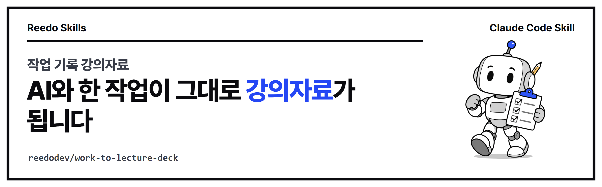

<p align="center"></p>

<p align="center">
<a href="https://github.com/reedodev/work-to-lecture-deck/actions/workflows/test.yml"></a>


</p>

# 작업 기록 강의자료 (work-to-lecture-deck)

AI와 나눈 실제 작업 기록에서 내가 한 말을 날짜와 함께 뽑아, '사람이 한 일 / AI가 한 일' 흐름표와 단계 카드로 된 한 파일짜리 HTML 강의자료를 만듭니다. 기록에 없는 말은 넣지 않습니다.

<!-- prereq-adapt -->
## 무엇이 필요한가요?

꼭 필요한 것은 Node 18 이상, 실제 작업 기록입니다. 권장·선택 준비물까지 정리한 표는 [SKILL.md의 준비물](skills/work-to-lecture-deck/SKILL.md#준비물-쓰기-전에-있어야-하는-것)에 있습니다.

## 바꿔 쓰기

에이전트에게 다음처럼 말하면 옵션을 바꿔서 실행합니다.

- "영상 말고 앱 만들기 과정으로 해 줘" → `steps`의 단계 이름과 개수를 그 작업에 맞게 바꿉니다(틀은 같습니다)
- "10분짜리 짧은 발표로" → `cardSteps`에 자세히 볼 단계만 2~3개 넣고, `seconds`로 장마다 시간을 줄입니다
- "이 키워드가 들어간 말만 뽑아 줘" → `collect-quotes.cjs --keyword 썸네일,목소리 --since 2026-10-01`

말과 옵션의 대응표는 [SKILL.md의 바꿔 쓰기](skills/work-to-lecture-deck/SKILL.md#바꿔-쓰기-이렇게-말하세요)에 있습니다.

## 설치

**Claude Code 플러그인으로 설치**

```
/plugin marketplace add reedodev/work-to-lecture-deck
/plugin install work-to-lecture-deck@work-to-lecture-deck
```

**폴더만 복사**

```bash
git clone https://github.com/reedodev/work-to-lecture-deck.git
cp -r work-to-lecture-deck/skills/work-to-lecture-deck ~/.claude/skills/
```

필요한 것: Node 18+

## 바로 해 보기

```bash
node skills/work-to-lecture-deck/scripts/build-deck.cjs skills/work-to-lecture-deck/examples/deck.json deck.html
```

자세한 절차, 옵션, 한계는 [SKILL.md](skills/work-to-lecture-deck/SKILL.md)에 있습니다. 에이전트가 이 파일을 읽고 그대로 따릅니다.

## 시험

`node tests/run.mjs`가 SKILL.md 형식을 검사하고 예시 파일로 스크립트를 실제로 실행합니다. 푸시할 때마다 GitHub Actions가 같은 시험을 돌립니다(위 test 배지).

## 만든 사람

**리도**, AI 좌충우돌 실습 중인 20년차 엔지니어입니다. 매일 AI에게 일을 맡기다가 막힌 부분을 고쳐 가며 이 스킬을 만들었습니다.
[YouTube @Reedodev](https://www.youtube.com/@Reedodev) · [Threads @reedo.dev](https://www.threads.com/@reedo.dev) · [GitHub @reedodev](https://github.com/reedodev)

같이 만든 다른 스킬: [옵시디언 3D 지식그래프](https://github.com/reedodev/obsidian-brain-3d) · [노트 먼저 찾아보기](https://github.com/reedodev/vault-recall) · [한국어 말투 점검](https://github.com/reedodev/korean-tone-check) · [네이버 황금키워드](https://github.com/reedodev/naver-golden-keywords) · [한글 양식 채우기](https://github.com/reedodev/hwpx-form-fill) · [TTS 끝소리 고치기](https://github.com/reedodev/tts-tail-fix) · [카드뉴스 렌더](https://github.com/reedodev/html-card-render) · [영상 비율 검사](https://github.com/reedodev/social-video-gate) · [유튜브 게시 점검](https://github.com/reedodev/youtube-publish-checklist)

---

## English

Turn real AI work logs (Claude Code sessions) into a single-file HTML lecture deck with a human/AI swimlane and per-step cards: what I said, what the AI did, what got fixed.

Install: `/plugin marketplace add reedodev/work-to-lecture-deck` then `/plugin install work-to-lecture-deck@work-to-lecture-deck`, or copy `skills/work-to-lecture-deck` into `~/.claude/skills/`. See [SKILL.md](skills/work-to-lecture-deck/SKILL.md) for the full procedure. MIT License; third-party models, fonts and libraries keep their own licenses.
